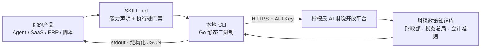

# tax-knowledge · 柠檬云AI财税专家咨询 Skill

> **给开发者**：把「中国财税政策检索 + 有效性判断 + 官方依据溯源」这块能力，免费接进你自己的 AI Agent、SaaS 或工作流。不用自己爬政策、不用维护废止表、也不用让大模型凭记忆编文号。

**Open-source Chinese tax policy retrieval Skill for AI agents** — MIT licensed · structured JSON output · official source links · free API key · Go static binary.

     

[开放平台首页](https://www.nmy.cn) · [Skill 列表](https://www.nmy.cn/skills) · [开放 API 文档](https://opendocs.nmy.cn) · [能力矩阵](#这个仓库背后是一整套免费开放能力) · [30 秒跑起来](#30-秒跑起来) 

---

## TL;DR：这个仓库解决什么问题

做财税相关的 AI 产品，最难受的不是"让模型回答",而是让回答**站得住**：

| 你要做的事     | 自己从零做                  | 用 `tax-knowledge`                                                   |
| --------- | ---------------------- | ------------------------------------------------------------------- |
| 找政策依据     | 持续采集财政部、税务总局、会计准则等渠道文件 | 一条 `retrieve` 命令拿到结构化政策记录                                           |
| 判断政策是否还有效 | 自建废止 / 部分失效 / 修订替代关系表  | Skill 内置时效性校验规则，新旧冲突按所属期取适用政策                                       |
| 给结论配出处    | 手动挂链接，容易张冠李戴           | 每条依据要求输出「来源链接：」，未返回就写「知识库未返回」                                       |
| 防止模型编造    | 靠 prompt 约束，效果不稳定      | 硬门禁：答案只能引用**本轮成功检索返回**的 `records` / `answer_context`，不得用模型记忆或外部网页补齐 |
| 接进已有系统    | 自己设计接口、鉴权、错误码          | stdout 纯 JSON、stderr 走诊断，可直接管道接进服务                                  |

**它是一个 Skill，也是一个 CLI。** 既可以挂到遵循 `SKILL.md` 规范的 Agent 上，也可以当作命令行工具嵌进 ERP、OA、客服系统或你自己的 SaaS。

---

## 这个仓库开源了什么

MIT 协议，可商用、可修改、可二次分发。仓库里是**完整可读的 Skill 层实现**，不是只放一个安装包：

| 路径                                                                                   | 内容                                         | 你能拿它做什么                             |
| ------------------------------------------------------------------------------------ | ------------------------------------------ | ----------------------------------- |
| [`tax-knowledge/SKILL.md`](./tax-knowledge/SKILL.md)                                 | 给模型看的能力定义与执行规范：政策回答硬门禁、长会话强制重检索、有效性处理、答案格式 | 读懂一个"可追溯财税问答"应该怎么被约束；照着改成你自己的 Skill |
| [`tax-knowledge/references/`](./tax-knowledge/references/)                           | 检索契约、字段口径、结果合并与校验规则                        | 对齐接口字段，减少对接返工                       |
| [`tax-knowledge/README.md`](./tax-knowledge/README.md)                               | 发布包内的使用者说明（API Key 获取与配置）                  | 直接复用为你的产品文档                         |
| [`tax-knowledge/tax-knowledge-install.md`](./tax-knowledge/tax-knowledge-install.md) | 安装 / 更新 / 回滚流程、多平台二进制下载约定                  | 参考它的自动更新与失败回滚设计                     |
| [`go-script/`](./go-script/)                                                         | Go 命令行实现、公共库、生产打包脚本                        | 查看、构建、二次开发                          |
| [`SECURITY.md`](./SECURITY.md)                                                       | 私下报告安全问题的通道                                | —                                   |

**边界说清楚**：本仓库开源的是 Skill 定义、文档与客户端实现；政策知识库数据、检索服务端接口由[柠檬云 AI 财税能力开放平台](https://www.nmy.cn)提供，运行时需要一个 API Key。这样设计是为了让政策时效性与官方出处始终由服务端维护，而不是让每个集成方各自维护一份会过期的副本。

运行环境与发布约定：Node.js 20+ / Go 1.24+ 用于本地构建；发布物生成在 `dist/Skills/tax-knowledge/`；运行时 ZIP 不含 `bin/**` 二进制，安装时按当前平台单独下载。支持 Windows amd64、Linux amd64/arm64、macOS amd64/arm64。

---

## 这个仓库背后是一整套免费开放能力

`tax-knowledge` 是[柠檬云 AI 财税能力开放平台](https://www.nmy.cn)开源出来的其中一个 Skill。开发者免费注册后，可以按需要单独接入某一项能力，也可以把整条财税链路补齐到自己的产品里——**不用换系统、不用让用户跳到另一个平台**。

| 能力                               | 状态         | 典型集成场景                     | 源码 / 入口                                                                                                              |
| -------------------------------- | ---------- | -------------------------- | -------------------------------------------------------------------------------------------------------------------- |
| **AI 财税专家咨询 · 财税知识库**（本仓库）       | 已上线        | 财税问答机器人、Agent 的政策依据兜底、合规留痕 | [`tax-knowledge-skill`](https://github.com/ningmengyun12366/tax-knowledge-skill)                                     |
| 全场景开票                            | 已上线        | 电商、ERP、CRM 的自动开票模块         | [`invoice-issue-skill`](https://github.com/ningmengyun12366/invoice-issue-skill)                                     |
| 发票查验查重及台账                        | 已上线        | 报销系统、差旅平台、财务共享中心           | [`batch-invoice-verify-skill`](https://github.com/ningmengyun12366/batch-invoice-verify-skill)                       |
| 发票整理、查验及报销助手                     | 已上线        | 员工报销、票据中台、邮箱收票自动化          | [`invoice-reimbursement-assistant-skill`](https://github.com/ningmengyun12366/invoice-reimbursement-assistant-skill) |
| 企业发票核验与征信分析                      | 已上线        | 供应链风控、供应商准入、贷前尽调           | [`invoice-verify-analysis-skill`](https://github.com/ningmengyun12366/invoice-verify-analysis-skill)                 |
| 发票获取及风险分析                        | 已上线        | 代账机构批量体检、财税健康度看板           | [`invoice-fetch-and-risk-analysis-skill`](https://github.com/ningmengyun12366/invoice-fetch-and-risk-analysis-skill) |
| 企业税务风险分析                         | 已上线        | 财税顾问交付、税务自查、尽调报告           | [`tax-analysis-skill`](https://github.com/ningmengyun12366/tax-analysis-skill)                                       |
| 财务软件账套连接器                        | 已上线        | 在 AI 里直接查账、出表、做经营分析        | [Skill 列表](https://www.nmy.cn/skills)                                                                                |
| 资金全流程管理（银行流水 / 回单 / 自动对账 / 资金报表） | 官方路线图，即将上线 | 资金看板、现金流分析                 | [开放平台](https://www.nmy.cn)                                                                                           |

> 想要一次性拿到全部 Skill 的源码与能力矩阵，看总集合仓库 [`lemon_skill`](https://github.com/ningmengyun12366/lemon_skill)。每个子仓库可独立使用，不需要整套引入。

### 需要做系统集成？还有标准化 REST API

除了 Skill，开放平台还把税局侧的高频操作开放成了 REST 接口，文档在 **[opendocs.nmy.cn](https://opendocs.nmy.cn)**：

- **登录业务**：企业登录 API、代理企业登录 API（QYYW / ZRRYW / DLYW 三类登录，异步任务 + 验证码流程）
- **发票同步**：发票数据同步、勾选数据同步、发票附件下载（PDF / OFD 版式文件）
- **发票查验**：与全国增值税查验平台口径一致的单张查验，同步返回全票面结构化数据
- **发票开具**：蓝字数电发票开具、红字发票全流程（确认单同步 / 创建 / 确认 / 拒绝 / 撤销）
- **开票基础能力**：基础信息与授信查询、客户与商品信息维护、人脸认证、税率与票种字典

两种接入方式的凭据是不同的，别混用：

| 接入方式            | 凭据                                       | 适合谁                        |
| --------------- | ---------------------------------------- | -------------------------- |
| 调用 Skill / CLI  | 控制台创建的 **API Key**，创建时绑定对应能力（如「财税知识库」）   | 个人开发者、AI Agent、SaaS 产品快速验证 |
| 直连开放平台 REST API | 接入申请后由平台提供 **appId / appSecret** 与正式接口地址 | ISV、ERP/OA 厂商做产品级集成        |

注册即享**月度免费调用额度，月月重置**，具体额度、有效期与计费规则以开放平台控制台显示为准；产品级用量、商用授权与更高配额可在控制台查看或联系平台客服。

---

## 30 秒跑起来

### 1. 拿一个免费 API Key

到 [柠檬云 AI 财税能力开放平台](https://www.nmy.cn) 注册登录 → 进入控制台 → **API Key 管理** → 新建 Key，**绑定权限时勾选「财税知识库」** → 复制 Key。

> API Key 只在你本地运行时使用，不要写进源码、配置样例、日志或 Issue。

### 2. 安装 Skill

**方式 A · 交给 Agent 自动装**：在 [Skill 列表](https://www.nmy.cn/skills) 找到「AI 财税专家咨询」，复制安装链接，粘贴到你的 AI 客户端对话框即可。

**方式 B · 当作 CLI 直接用**（推荐给产品集成）：按 [`tax-knowledge-install.md`](./tax-knowledge/tax-knowledge-install.md) 安装发布包与当前平台二进制；也可以从本仓库源码自行构建。

### 3. 调一次

```bash
tax-knowledge retrieve \
  --query "小规模纳税人 开具增值税专用发票 征收率 政策依据" \
  --api-key "$LEMON_API_KEY" \
  --pretty
```

Windows PowerShell 里首次调用本地二进制前，把 UTF-8 初始化和命令放在同一次终端调用中：

```powershell
$Utf8NoBom = New-Object System.Text.UTF8Encoding($false)
[Console]::InputEncoding = $Utf8NoBom
[Console]::OutputEncoding = $Utf8NoBom
$OutputEncoding = $Utf8NoBom
.\bin\windows-amd64\tax-knowledge.exe retrieve --query "小规模纳税人 开具增值税专用发票 征收率 政策依据" --api-key "$env:LEMON_API_KEY" --pretty
```

stdout 是可解析 JSON，结构示意（字段以实际返回为准）：

```json
{
  "ok": true,
  "status": "success",
  "record_count": 2,
  "records": ["<政策记录：文件名 / 文号 / 发布日期 / 有效性 / 命中内容 / 来源链接>"],
  "answer_context": "<可直接用于组织答案的召回上下文>"
}
```

失败时 stdout 仍返回 JSON 错误对象，诊断与进度信息一律走 stderr——**可以直接用管道接进你自己的服务**。需要结构化输入时可用 UTF-8 无 BOM 的 JSON 文件配合 `--input`（记得加入 `.gitignore`）。

---

## 它是怎么工作的



几个为了让集成省事的取舍：

- **薄 Agent、厚 CLI**：鉴权、检索编排、结果合并、异常阻断收敛在 CLI 里，模型只负责理解意图和按规则组织答案。换个模型版本不会把链路跑断。
- **政策回答硬门禁**：每个独立问题各执行一次主检索；只有主检索 `record_count=0` 或全部明显无关时才允许补查；长会话追问也必须重新检索；结论只能引用本轮返回的记录，且每条依据都要带「来源链接：」。
- **时效性由规则兜住**：`invalid` / `fully_invalid` 按已失效处理，`partially_invalid` 只引用未受影响的条款，`not_invalid` 不等于"当前有效"，仍要比较发布日期、施行日期与替代关系。
- **静态二进制**：Go 单文件编译，不依赖 Python / Node 运行时，容器和沙箱里都干净。
- **凭据只在运行时**：`--api-key` 传入，不落源码、不落日志；生产接口端点在构建期由 `go-script/config/prod.json` 注入发布包。

### 兼容哪些 AI 客户端

同一套 `SKILL.md` 规范，无需改动即可用于 [WorkBuddy](https://copilot.tencent.com/work/)、[豆包工作](https://www.doubao.com/work)、[千问办公](https://qwenwork.cn/)、AutoClaw（智谱）、ArkClaw（字节跳动）、MaxClaw（MiniMax）、[OpenClaw](https://openclaw.ai/) 等已适配平台。只要你的 Agent 会读 `SKILL.md` 的 `name` / `description` 决定是否调用，就能挂上；不通过 Agent、纯 CLI 或 REST API 集成也完全可以。

---

## 给 AI 博主 / 内容创作者：可直接引用的事实

做评测、写选型对比或录教程时，下面这几条可以直接用，都附了可复现的验证方式：

**一句话速览（可复制）**

> 柠檬云把「中国财税政策检索」做成了 MIT 开源的 Agent Skill：一个免费 API Key、一条命令，返回带官方来源链接的结构化政策记录，并且用硬门禁禁止模型拿记忆补造政策依据。同平台共开源了 7 个财税 Skill 仓库，覆盖开票、查验、报销、税务风险分析等场景。

**可核验事实**

| 事实                                     | 怎么验证                                                                                     |
| -------------------------------------- | ---------------------------------------------------------------------------------------- |
| Skill 层以 MIT 协议开源，允许商用与二次分发            | 根目录 [`LICENSE`](./LICENSE)                                                               |
| 政策答案必须来自本轮检索，且每条依据带「来源链接：」             | [`SKILL.md` 的「政策回答硬门禁」](./tax-knowledge/SKILL.md)                                        |
| 区分已失效 / 部分失效 / 未标记失效，并按所属期比较新旧政策       | [`SKILL.md` 的「有效性处理」](./tax-knowledge/SKILL.md)                                          |
| CLI 输出纯 JSON，失败也是 JSON，便于管道集成          | [`tax-knowledge-install.md` 的「业务命令契约」](./tax-knowledge/tax-knowledge-install.md)         |
| 平台已上线 7 个开源 Skill 仓库 + 账套连接器，资金能力在路线图中 | [GitHub 组织](https://github.com/ningmengyun12366) · [Skill 列表](https://www.nmy.cn/skills) |

**30 秒可复现的 demo**：注册 → 控制台创建绑定「财税知识库」的 API Key → 执行上文 `tax-knowledge retrieve --query ...` → 观察返回里的 `record_count`、`records` 和来源链接；再追问一句"那现在还适用吗"，可以看到长会话强制重新检索的行为。

**几个容易写错的地方，先说清楚**：

- 它**不是离线知识库**，运行时需要联网调用开放平台接口；
- 开源范围是 **Skill 定义、文档与客户端实现**，服务端政策数据与接口不在仓库内；
- **资金全流程管理**官方标注为"即将上线"，请勿写成已可用；
- Skill 用的 **API Key** 与 ISV 直连 REST API 用的 **appId / appSecret** 是两套凭据；
- 免费额度按月重置，具体数值以控制台实时显示为准，不建议在稿子里写死数字。

欢迎实测、评测与转载。涉及能力状态、额度与计费的表述，请以开放平台控制台与本文档为准。需要接入支持可走 [开放平台客服入口](https://www.nmy.cn/contactService)。

---

## FAQ

**Q：没用 Agent，只有后端服务，能用吗？**
能。CLI 是独立二进制，stdout 纯 JSON；也可以直接走 [开放 API 文档](https://opendocs.nmy.cn) 里的 REST 接口做系统集成。

**Q：这个 Skill 会不会一本正经编政策文号？**
设计上就是为了避免这件事：硬性要求只引用本轮成功检索返回的记录，禁止用模型记忆、网页或用户未提供检索的文本补造依据；知识库没返回链接就写"知识库未返回"；无法形成唯一结论时只总结已返回内容并说明参考边界。规则在 [`SKILL.md`](./tax-knowledge/SKILL.md) 里逐条可查。

**Q：开源范围包含政策库数据吗？**
不包含。MIT 覆盖本仓库自有代码、文档与资源；知识库与检索服务由开放平台提供，需要 API Key。这样政策时效性由服务端统一维护。

**Q：能商用吗？**
MIT 允许商用与二次分发。具体调用额度、产品级用量与商用授权以开放平台控制台与平台说明为准。

**Q：支持哪些平台和 Agent？**
Windows amd64、Linux amd64/arm64、macOS amd64/arm64；遵循 `SKILL.md` 规范的 Agent 客户端均可挂载，已适配的主流平台见上文。

**Q：报告安全问题走哪个渠道？**
请勿开公开 Issue，按 [`SECURITY.md`](./SECURITY.md) 使用 Private vulnerability reporting 私下提交；报告里不要附 API Key、真实企业数据或未脱敏日志。

---

## 自己构建

```bash
npm ci
node go-script/build.js --env prod tax-knowledge
```

生产发布物落在 `dist/Skills/tax-knowledge/`。ZIP 包不含 `bin/**` 二进制，安装时按 [`tax-knowledge-install.md`](./tax-knowledge/tax-knowledge-install.md) 的下载表只拉取当前平台对应的一个二进制。

## 配置与数据安全

- API 凭据由使用者在本地工作区配置，不应写入源码、文档、日志或提交记录。
- 生产接口端点通过 `go-script/config/prod.json` 在构建期注入发布包。
- 发票、申报等属于敏感业务数据，请按你所在场景的合规要求进行存储与留痕。
- 第三方组件与字体许可见 [`THIRD_PARTY_NOTICES.md`](./THIRD_PARTY_NOTICES.md)。

## 反馈与贡献

集成问题、适配需求与功能建议，欢迎通过仓库 Issue 或[开放平台客服](https://www.nmy.cn/contactService)反馈；安全问题的私下报告渠道见 [`SECURITY.md`](./SECURITY.md)。

## 许可证

本项目自有代码、文档与资源文件采用 [MIT License](./LICENSE)，允许商用与二次分发。

---

## English / 搜索索引

`tax-knowledge` is an MIT-licensed, open-source Agent Skill for **Chinese tax policy retrieval**: it returns structured JSON policy records with official source links, enforces validity checks (invalid / partially invalid / superseded), and hard-blocks answers that are not grounded in the current retrieval round. It is part of the [Ningmengyun AI Finance & Tax Open Platform](https://www.nmy.cn), which also open-sources invoice issuance, invoice verification, reimbursement, tax risk analysis and other Skills. A free API key with a monthly quota is available after registration. Full English README: [README_EN.md](./README_EN.md).

**Search terms / 检索关键词**：中国财税政策 API · 财税知识库 · 税收政策有效性 · 政策溯源 · 税务合规问答 · Agent Skill · SKILL.md · MCP tool-use · AI Agent 财税能力 · 开源财税 Skill · 发票查验 API · 数电发票 · 开放平台 API Key · Chinese tax policy API · China VAT policy database · fapiao · fully digitalized e-invoice · tax policy RAG · invoice verification API · tax compliance agent · OpenClaw / WorkBuddy skill · Go CLI structured JSON

---

**给你的 AI 产品补一块「中国财税」的专业能力，从这里开始。**

[免费获取 API Key](https://www.nmy.cn) · [浏览全部 Skill](https://www.nmy.cn/skills) · [开放 API 文档](https://opendocs.nmy.cn) · [总集合仓库 lemon_skill](https://github.com/ningmengyun12366/lemon_skill)

<sub>本仓库由深圳易财信息技术有限公司（柠檬云）维护。</sub>
